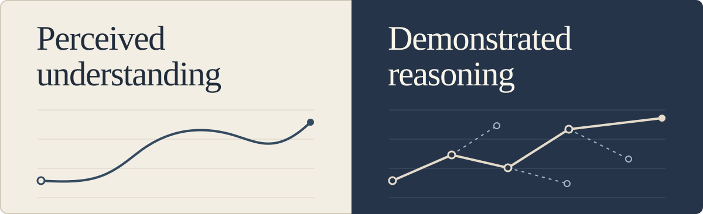
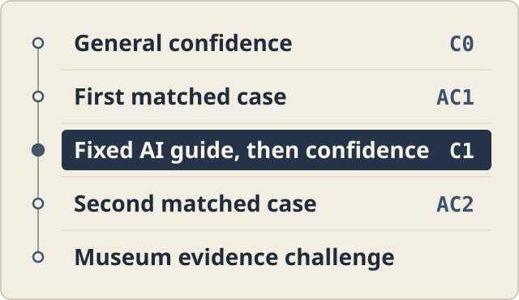

<p align="center">
  
</p>

<h1 align="center">Borrowed Understanding</h1>

<p align="center">An independent study of confidence and causal reasoning following AI-written explanations.</p>
<p align="center"><strong>Louis Wren David</strong> · Exploratory human pilot</p>

<p align="center">
  <a href="#research-question">Question</a> ·
  <a href="#study-design">Study design</a> ·
  <a href="#research-development">History</a> ·
  <a href="#research-status">Status</a> ·
  <a href="#research-implementation">Code</a> ·
  <a href="#research-materials">Materials</a>
</p>

---

## Research question

**How closely does confidence after reading an AI-written explanation correspond to the reasoning someone can demonstrate on their own?**

In AI-assisted learning, a clear explanation can make a subject feel more intelligible. A separate question is what the learner can do once the explanation is out of view. Can they trace the mechanism in a new case, work out what would happen under a change, and identify when the evidence leaves another explanation open?

Borrowed Understanding records **perceived understanding** through self-reported confidence and examines **demonstrated reasoning** through written responses to fictional causal problems. The two measures can move together or diverge. The exploratory design leaves both possibilities open.

## Study design

**BU-E1.0 · The Other Explanation** is a single-arm, within-participant pilot. Participants explain one case, read the same fixed AI-written guide, then explain a second case without the guide in view. The library and concert cases were designed as a matched pair. Their order alternates across enrollments so each case can appear before or after the guide. An unfamiliar museum challenge follows both cases.

<p align="center">
  
</p>

The guide is prewritten and identical within an instrument revision. Evaluation and the optional personalized **Deep Echo** experience happen after final submission. Deep Echo offers a fictional interpretation of the participant’s writing for reflection. It has no diagnostic or scoring role.

### Measurements

| Measure | What it captures |
| --- | --- |
| **C0 / C1** | General confidence in reasoning through an unfamiliar causal claim unaided. Recorded before the first case and after the guide, respectively. |
| **AC1 / AC2** | Confidence in the explanation just written. Recorded alongside the first and second matched answers in the current revision. |
| **M / I / W** | Case-specific evidence of **model fidelity**, **intervention reasoning**, and **warrant and scope** in the written responses. |

The four confidence ratings use a five-point ordinal scale. The museum challenge contributes a written response only. Automated M/I/W assessments are preliminary and kept distinct from independent human review.

## Research development

| Instrument | Role |
| --- | --- |
| **BU-0.8 · Borrowed Understanding** | The original research framework that advanced to the next stage of the University of Oxford / Reuben College Generation AI Research Prize. The submission disclosed that no human observations had been collected at that point. |
| **LL-1.0 · The Last Light** | An earlier human feasibility instrument. Participants explained the same fictional event before and after a fixed guide, then faced revised evidence and an additional reasoning problem. |
| **BU-E1.0 · The Other Explanation** | The current instrument. It uses counterbalanced matched cases, separates general and answer-specific confidence, and adds an unfamiliar museum evidence challenge. |

The versions trace the development of the study design. Their tasks, measures and cohorts differ, so comparisons across versions cannot establish change over time.

## Research status

The current BU-E1.0 instrument is deployed with restricted access. Engineering rehearsals exercised both case orders with synthetic responses, and the implementation supports separate assessor records. Those checks establish workflow behavior. Human recruitment totals, independent scoring outcomes, and aggregate findings are outside this release.

Interpretation is limited by the small convenience-sample design, lack of a randomized comparator, possible practice and order effects, possible prior exposure to related instruments, and preliminary automated ratings. Before-and-after observations can describe patterns within this pilot. A causal estimate of the guide’s effect would require a comparison design.

**Planned paper** · *Perceived Understanding and Independent Causal Reasoning Following AI-Generated Explanations: An Exploratory Human Pilot Study*. The title is provisional. Aggregate results and the paper are reserved for separate scientific and privacy review.

## Research implementation

The November 21, 2026 code release follows the November 20 Oxford submission. It extracts the BU-E1.0 instrument logic, case order, confidence validation, and assessment checks from the source revision verified against the live study. Synthetic placeholders stand in for the study cases and guide. The assessment validator checks record structure and evidence linkage.

With **Node.js 22.18+**, run the tests and synthetic replay from the repository root. No packages or credentials are needed.

```sh
node --test test/offline.test.mjs
node examples/synthetic.mjs
```

The example exercises both case orders and prints a deterministic replay digest. It contains no human observations. [Architecture, source provenance, and reproducibility](docs/REPRODUCIBILITY.md)

## Research materials

- [Methodology](docs/METHODOLOGY.md) — participant sequence, confidence measures, reasoning assessment, and post-submission reflection.
- [Development history](docs/DEVELOPMENT_HISTORY.md) — original proposal, feasibility instrument, and changes in the current study.
- [Limitations and future work](docs/LIMITATIONS_AND_FUTURE_WORK.md) — inference limits, review priorities, and conditions for a later report.

## Research access and authorship

**Louis Wren David** conducts the research independently, without institutional sponsorship or affiliation. [Study entry point · private access required](https://study.wrencomplex.com/)

The public documentation and extracted source support review of the design, measurement logic, and software behavior. Participant-level records, consent records, private operational materials, and complete scoring keys are restricted. Exact replication from this repository alone is therefore outside the scope of this release. Any future aggregate release is subject to scientific and privacy review.
